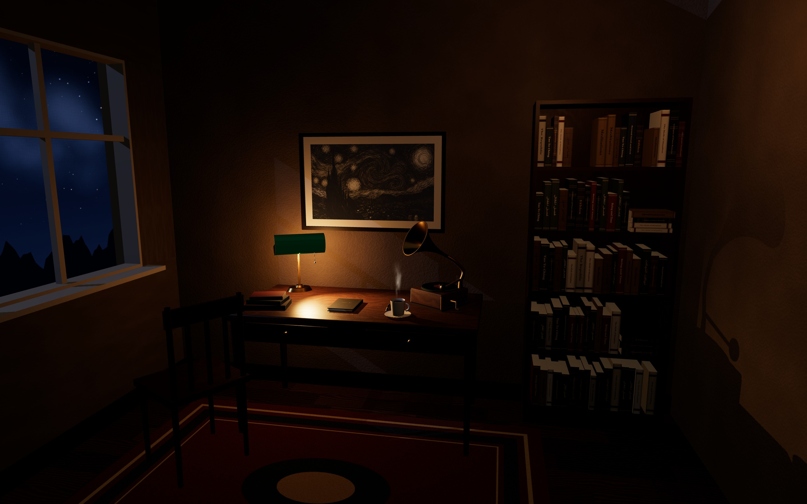
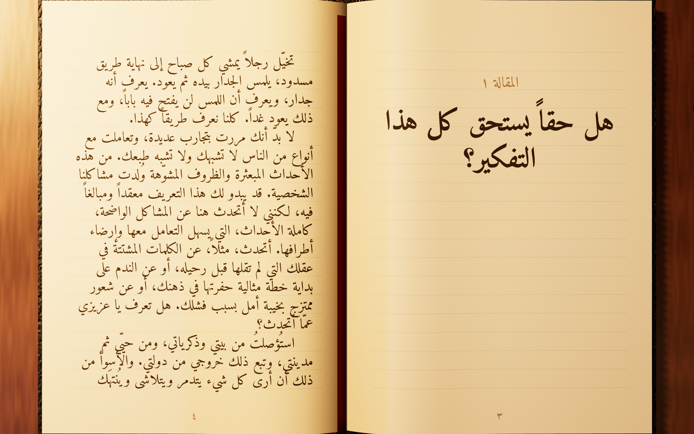
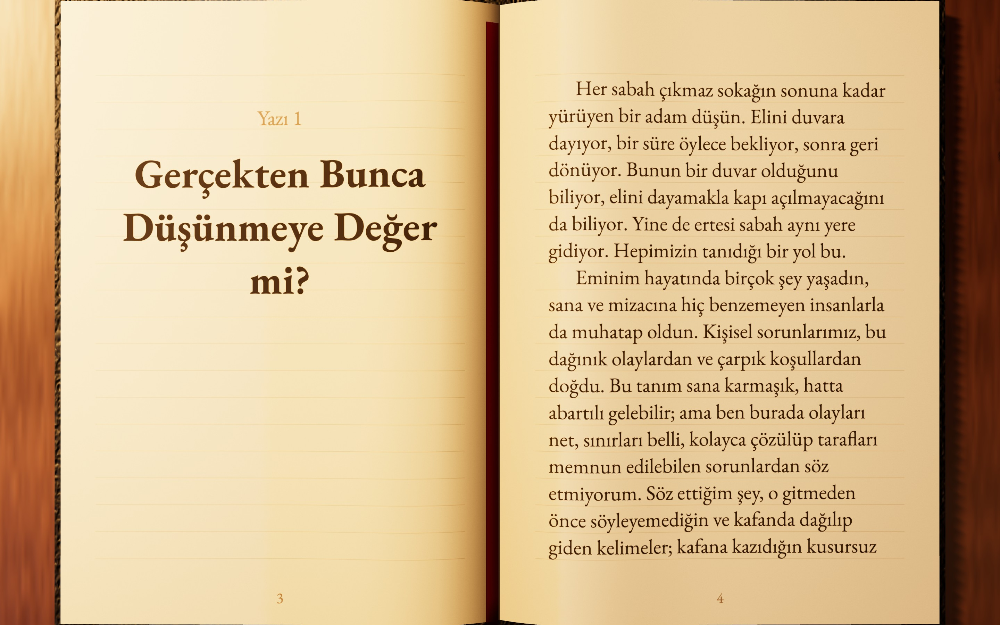
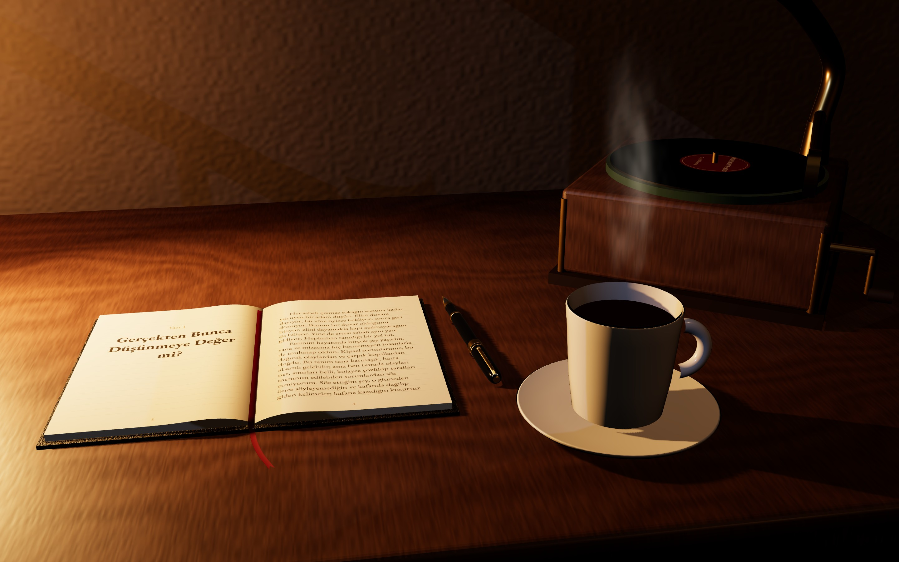

<div align="center">

# دفتر الأفكار · Düşünce Defteri

**A photorealistic 3D writer's study that doubles as a bilingual philosophy blog.**
Scroll to walk up to the desk, then read the articles as pages of a real notebook.

React · Three.js · React Three Fiber · Supabase



</div>

---

## What this is

A blog told as a room. You arrive in a dim study — walnut desk, banker's lamp, a horn gramophone, coffee with
steam, a shelf of philosophy — and the page itself is the camera: scrolling walks you up to the desk while a
closed notebook opens. The page ends exactly where the camera lands on the two-page spread, and from there
reading goes sideways, by turning pages.

The reader first picks **Arabic** or **Turkish**. Nothing is ever translated automatically: every article is
written by hand in both languages, and the notebook loads strictly the chosen one. Arabic is laid out
right-to-left with the page turning the other way; Turkish reads left-to-right.

## The notebook





## On the desk



## Features

- **A scroll-driven camera.** GSAP ScrollTrigger scrubs a camera path from a wide shot of the room to the
  open notebook; the notebook opens and the lens tightens as you approach, then locks on the spread.
- **Real pagination.** Article text is measured with the page's own font and flowed onto the ruled lines, so
  every article becomes as many pages as it needs, with folios, headings and a contents page.
- **Page turns with a curl.** Buttons, `←` / `→`, swipes, or tapping a page. The turning sheet bends as it
  travels, and turns the opposite way in Arabic.
- **Search that riffles to the page.** Type in either language (diacritics and Turkish letters optional); the
  notebook flips through the pages to the match and marks the words on the paper.
- **Day and night.** Night is lit by the lamp and a window of stars; day by soft sun.
- **A gramophone that actually plays.** Clicking the gramophone itself — and nothing else — starts a looping
  track with a soft fade, while musical notes drift up from the horn. The playlist is a small data file.
- **Publish from the browser.** A button in the corner opens an editor with Arabic and Turkish fields.
  The passcode is checked inside the database, never in the site's code, and wrong guesses are rate-limited.
- **Procedural everything.** The floor, desk, plaster, leather, paper, fountain pen and gramophone are built
  from code and baked textures; no model downloads.

## Tech stack

| Layer | Choice |
|---|---|
| 3D | Three.js r186 through React Three Fiber and drei, ACES filmic tone mapping, PCF shadows |
| Motion | GSAP + ScrollTrigger for the camera, `useFrame` for page turns |
| UI | React 19, TypeScript, plain CSS |
| Database | Supabase (Postgres, row-level security, a `security definer` publish function) |
| Audio | HTML audio with time-based fades, plus a generative Web Audio fallback |
| Build | Vite |
| Hosting | Vercel |

## Getting started

```bash
npm install
npm run dev        # http://localhost:5173
npm run build      # typecheck + production build
```

Without a database the site still runs and shows an empty notebook. To publish articles for every visitor:

1. Create a project at [supabase.com](https://supabase.com).
2. SQL Editor → paste `supabase/schema.sql` → replace `CHANGE-ME` at the bottom with your passcode → Run.
   (Don't save the real passcode back into the file.)
3. Copy `.env.example` to `.env.local` and fill in the two values from Project Settings → API:

```
VITE_SUPABASE_URL=https://your-project.supabase.co
VITE_SUPABASE_ANON_KEY=your-anon-or-publishable-key
```

On Vercel, set the same two variables under Project Settings → Environment Variables, then redeploy.
Only the public (anon / publishable) key belongs here; never the `service_role` key.

Add `?debug` to the URL to see the scroll progress.

## Where things live

```
src/
  scene/
    layout.ts            every size, camera pose and scroll milestone, in metres
    Experience.tsx       the <Canvas>, tone mapping, shadows
    Room.tsx · Desk.tsx · Notebook.tsx · Props.tsx · Bookshelf.tsx · NightSky.tsx
    Gramophone.tsx       the gramophone and its floating notes
    FountainPen.tsx      the pen, cap posted, beside the notebook
    Lighting.tsx         day / night light values
    book.ts              pagination, spreads, page turns, search, go-to-page
    pageContent.ts       how one page is painted (rules, ink, highlighter)
    search.ts            forgiving matching for Arabic and Turkish
    content.ts           the Article type (title_ar, content_ar, title_tr, content_tr)
    library.ts           published articles from Supabase + any built into content.ts
    i18n.ts              interface strings for both languages, written by hand
    audio.ts             global play / pause store (also window.studyAudio)
    wallArt.ts           image slot for the wide frame over the desk
  data/playlist.ts       the gramophone's tracks, volume and fades
  ui/                    search bar, article editor, Instagram link, suggest-a-topic popup
  lib/supabase.ts        client, configured from env variables
supabase/schema.sql      articles table, read-only policy, passcode hash, publish_article()
public/
  art/wide.png           the wide picture on the wall
  audio/                 the gramophone's music (see its README)
docs/preview/            screenshots used in this README
```

Article text uses a plain format: a blank line starts a new paragraph, and a line beginning with `## ` is a
subheading.

## Credits

- Music: *Gymnopédie No. 1* by Erik Satie, performed by Robin Alciatore for [Musopen](https://musopen.org)
  (public domain), via Wikimedia Commons.
- Fonts: Amiri and EB Garamond, from Google Fonts.

## Licence

Released under the [MIT Licence](LICENSE). The articles are © their author.
